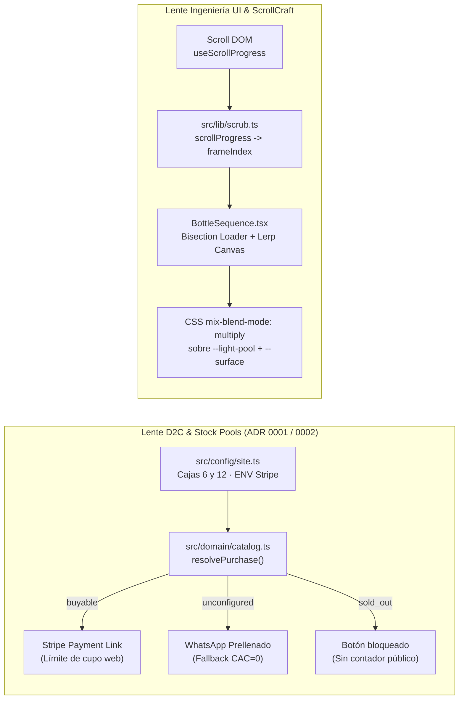

# Guía Técnica y de Dominio: Landing ScrollCraft «Almazara Nocturna» (`001`)

## 1. Introducción y Contextualización del Problema
El reto de **Aceite Negro Picudo** combina dos fuerzas aparentemente opuestas:
1. **Alta gama visual**: posicionar un AOVE de cosecha temprana (octubre 2026, variedades *Picudo* y *Carrasqueño*) con estética editorial capaz de justificar su valor y servir de carta de presentación ante tiendas gourmet y HORECA.
2. **Verdad artesanal sin clichés**: reflejar que se trata de un lote único y finito (1.500 litros en 3.000 botellas de 500 ml) elaborado por una familia, tres trabajadores en el campo y la cooperativa familiar, **sin recurrir a eslóganes sentimentales ni contadores artificiales de urgencia**.

---

## 2. Fundamentos Teóricos (Doble Lente)

### Lente de Ingeniería de Software
- **Separación estricta entre cálculo puro y efectos DOM**: Toda la matemática de scroll ([`src/lib/scrub.ts`](../src/lib/scrub.ts)) y la estrategia de carga por bisección binaria ([`src/lib/frames.ts`](../src/lib/frames.ts)) viven en funciones puras sin referencias a `window` ni `document`. Esto permite verificar en milisegundos bordes degenerados (`NaN`, `sectionHeight <= viewportHeight`, monotonicidad en 100 pasos) con Vitest antes de tocar el navegador.
- **Precarga progresiva por bisección (`loadOrder`)**: En vez de cargar `f001..f120` secuencialmente (lo que dejaría la segunda mitad del giro vacía si el usuario hace scroll rápido), `loadOrder(120)` carga primero los extremos `[0, 119]`, luego el punto medio `59`, luego cuartos `[29, 89]`, refinando la resolución angular en cada pasada mientras `nearestAvailable` dibuja siempre el fotograma cargado más próximo.
- **Fusión óptica sin recuadros (`mix-blend-mode: multiply`)**: Nivelando en `scripts/build-media.mjs` el blanco de estudio del vídeo 360° hasta `RGB(255,255,255)` y pintando sobre un escenario sticky con `background: var(--surface)` y un foco radial `--light-pool`, la multiplicación convierte el blanco puro en el color exacto del foco y funde los márgenes en el negro aceituna (`#0d0e0a`) sin que exista jamás una «vitrina» rectangular.

### Lente de Dominio Técnico (D2C Gourmet Zero-Backend)
- **Economía unitaria del vidrio**: Vender botellas sueltas de 500 ml penaliza el margen por el coste fijo del embalaje homologado anti-rotura y el porte (`~5–6 €`). Presentar la oferta como filas editoriales de **Caja de 6 (3 L)** y **Caja de 12 (6 L)** diluye el envío y eleva el ticket medio sin fricción de carrito.
- **Degradación elegante pre-lanzamiento (`resolvePurchase`)**: Mientras no estén creados los enlaces `https://buy.stripe.com/...` en `.env`, el dominio transiciona automáticamente cada fila al estado `unconfigured`, transformando el CTA en un pedido directo por WhatsApp con el formato ya redactado. Cuando se añade el enlace en Cloudflare Pages, pasa a `buyable` sin tocar componentes.

---

## 3. Disección del Código Implementado
- **Tokens y Gobernanza Anti-Slop**: [`src/styles/tokens.css`](../src/styles/tokens.css) concentra los 13 colores y la escala tipográfica/espacial declarados en [`docs/brain/design.md`](../docs/brain/design.md). Ningún componente ni hoja CSS secundaria declara colores hexadecimales sueltos.
- **Curaduría documental de vídeo (`scripts/build-media.mjs`)**: De `Aceite-liquido.mp4` se extraen únicamente las ventanas `00:05.5–00:08.0` y `00:14.5–00:17.5` recortando la parte superior para eliminar el recogedor verde y ralentizando a `0.5×` el chorro de aceite recién hecho.
- **Verificación Agent Eyes ([`tests/e2e/ui-health.spec.ts`](../tests/e2e/ui-health.spec.ts))**: Cuatro pruebas en Chromium real verifican el árbol de accesibilidad (`ariaSnapshot`), la ausencia de scroll horizontal a `375px` y `1280px`, la progresión monótona sin saltos bruscos de los 120 fotogramas y el respeto a `prefers-reduced-motion`.

---

## 4. Lecciones Aprendidas y Buenas Prácticas
1. **Cuidado con los contextos de apilamiento (`stacking contexts`) al usar `mix-blend-mode`**: `position: sticky` crea su propio contexto de apilamiento; declarar `background: var(--surface)` explícitamente en el contenedor sticky garantiza que `multiply` mezcle contra negro opaco y nunca revele bordes blancos.
2. **Inspección visual + semántica combinadas**: Los tests unitarios validan la lógica y `ariaSnapshot` valida la semántica accesible, pero inspeccionar el render real en `375px` y `1280px` permitió detectar y pulir detalles tipográficos como `font-variant-numeric: lining-nums` en `Cormorant Garamond` y la alineación tipo carta de precios en móvil.
