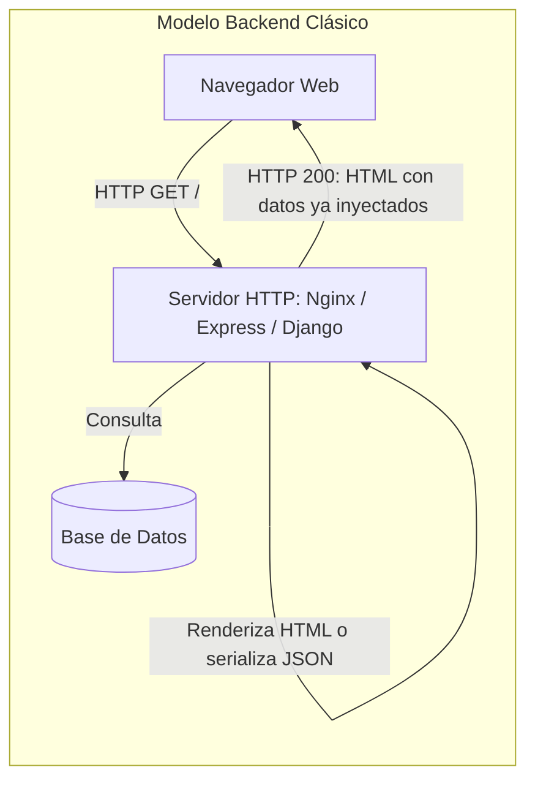
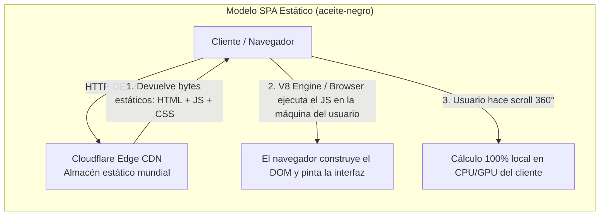
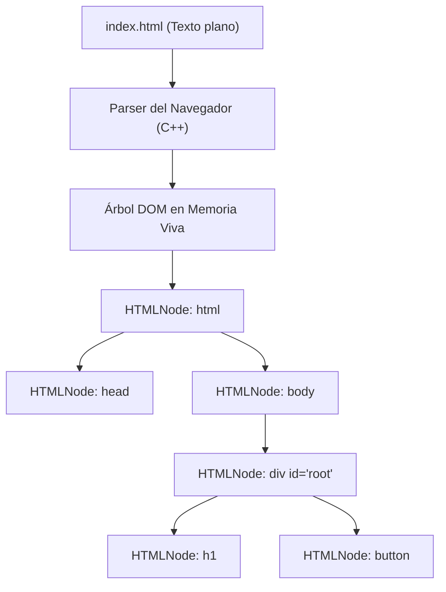
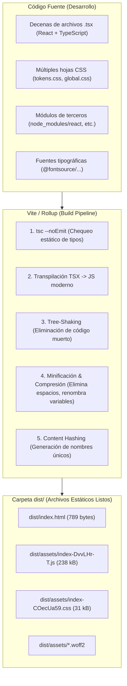
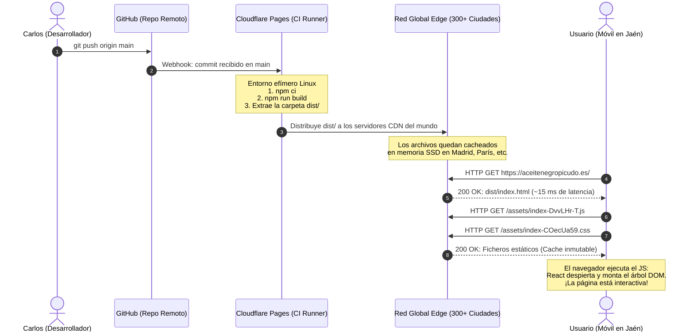

# Guía Técnica: El Frontend por Dentro (De Backend a Frontend) (`002`)

> **Audiencia**: Desarrolladores backend que quieren entender cómo funciona realmente la web moderna en el cliente: qué es el DOM, qué hace React, qué es Vite, qué es un *bundle* y cómo se sirve todo esto en internet desde un Edge CDN como Cloudflare Pages.
> **Caso Práctico**: La arquitectura real de [`aceite-negro`](file:///home/carlos/aceite-negro/).

---

## 1. El Choque de Paradigmas: Servidor vs. Navegador

Para un desarrollador backend tradicional (Python, Go, Java, PHP, C# o Node.js), la arquitectura mental de una aplicación web suele ser esta:



En este modelo:
1. Hay un **proceso persistente** corriendo en un servidor, escuchando en un puerto TCP (`:80`, `:443`, `:3000`).
2. Por cada petición entrante, el servidor consume CPU y RAM para ejecutar código, consultar bases de datos y escupir una respuesta.
3. Si el servidor se apaga o la base de datos se satura, el servicio cae.

### ¿Qué pasa en una Single Page Application (SPA) estática como `aceite-negro`?

En `aceite-negro` **no existe ningún servidor de aplicaciones ejecutando código en producción**. No hay Node.js corriendo en segundo plano, no hay Python, no hay base de datos y no hay puertos abiertos.



Todo el código de nuestra aplicación se ejecuta **en la máquina del usuario final** (su móvil, portátil o tablet), dentro del motor de JavaScript del navegador (como V8 en Chrome o JavaScriptCore en Safari).

---

## 2. La Santísima Trinidad del Navegador: HTML, CSS y el DOM

Para entender qué hace React o Vite, primero hay que entender qué es lo único que un navegador web sabe interpretar: **HTML, CSS y JavaScript**.

### 2.1. ¿Qué es el HTML? (El plano textual)
El HTML no es un lenguaje de programación. Es un formato de texto estructurado con etiquetas (`<header>`, `<p>`, `<button>`). Es simplemente un **stream de texto declarativo** que le dice al navegador qué piezas de contenido existen.

### 2.2. ¿Qué es el DOM (Document Object Model)?
Cuando el navegador descarga los bytes de un archivo HTML (por ejemplo, [`index.html`](file:///home/carlos/aceite-negro/index.html)), **no trabaja directamente sobre el texto**.

El navegador tiene un parser que lee el texto de arriba abajo y crea una **estructura de datos en memoria viva (en C++) en forma de árbol**: el **DOM**.



Cada etiqueta se convierte en un objeto (`HTMLElement`) con propiedades, métodos y eventos:
- Puedes acceder a él desde JavaScript: `document.getElementById('root')`.
- Puedes mutar sus hijos: `root.appendChild(document.createElement('p'))`.
- Puedes escuchar eventos del usuario: `btn.addEventListener('click', () => { ... })`.

> [!NOTE]
> **El DOM es una API en memoria viva**, no un archivo. Mutar el DOM es una operación costosa para el navegador porque cada cambio puede obligarle a recalcular la geometría de la pantalla (*Layout*) y volver a pintar los píxeles (*Paint*).

### 2.3. ¿Qué es el CSS y el Render Tree?
El CSS define las reglas cosméticas y de maquetación (color, tamaño, cuadrículas Grid/Flexbox, posición fija o sticky).
1. El navegador parsea el CSS y genera el **CSSOM** (*CSS Object Model*).
2. Cruza el **DOM** + **CSSOM** para crear el **Render Tree** (solo los nodos que realmente se ven; excluye `<head>` o elementos con `display: none`).
3. **Layout / Reflow**: Calcula las coordenadas exactas `(x, y, ancho, alto)` de cada caja en la pantalla.
4. **Paint**: Rellena los píxeles (colores, sombras, texto).
5. **Composite**: La GPU compone las capas visuales en la pantalla (aceleración por hardware).

### 2.4. ¿Dónde entra JavaScript?
JavaScript es el único lenguaje de programación nativo que el motor del navegador puede ejecutar. Su función histórica principal ha sido actuar como un titiritero: escuchar eventos del usuario (clicks, scroll, teclado) y **mutar el DOM** en respuesta.

---

## 3. El Salto de Abstracción: ¿Por qué TypeScript y React?

Si con HTML, CSS y JavaScript crudo ya se puede hacer una web, ¿por qué usamos TypeScript y React?

### 3.1. JavaScript vs. TypeScript (Tipado estático vs. Dinámico)
- **JavaScript**: Tipado dinámico y débil. Los errores de tipo (`TypeError: Cannot read properties of undefined`) explotan en tiempo de ejecución en la cara del usuario.
- **TypeScript**: Es JavaScript con un sistema de tipos estático desarrollado por Microsoft.
  
> [!IMPORTANT]
> **Ningún navegador del mundo entiende TypeScript**. Ni Chrome, ni Safari, ni Firefox son capaces de ejecutar un archivo `.ts` o `.tsx`.
> TypeScript existe **únicamente en tu entorno de desarrollo y compilación**. El compilador de TypeScript (`tsc`) analiza el código, valida que los tipos coincidan y **elimina todos los tipos**, emitiendo JavaScript puro estándar.

> [!NOTE]
> **Analogía directa con Python**: Si vienes de Python, esto es exactamente lo mismo que ocurre con los **Type Hints** (`def obtener_precio(item_id: str) -> int:`).
> En tiempo de ejecución, el intérprete CPython **ignora por completo** las anotaciones de tipos. Necesitas una herramienta estática en desarrollo o en tu CI como **`mypy`** o **`pyright`** para analizar el código y alertarte de inconsistencias antes de desplegar. En el ecosistema web, **TypeScript (`tsc`) es el `mypy` del mundo JavaScript**: chequea los tipos en tu máquina, te garantiza que todo encaja y luego desaparece por completo al emitir el JavaScript final.

En [`src/domain/catalog.ts`](file:///home/carlos/aceite-negro/src/domain/catalog.ts), por ejemplo, definimos:
```typescript
export interface FormatItem {
  id: string;
  name: string;
  volumeMl: number;
  priceCents: number;
}
```
Si en un componente intentamos acceder a `format.precio`, el compilador falla inmediatamente antes de que el código llegue a producción.

### 3.2. El problema del JavaScript "Vanilla" (Manipulación Imperativa)
Imagina que queremos implementar el botón de la ficha nutricional de `aceite-negro` con JavaScript crudo:

```javascript
// Enfoque imperativo tradicional (Vanilla JS)
const boton = document.getElementById('toggle-ficha');
const modal = document.getElementById('modal-ficha');
let isOpen = false;

boton.addEventListener('click', () => {
  isOpen = !isOpen;
  if (isOpen) {
    modal.classList.add('visible');
    modal.setAttribute('aria-hidden', 'false');
    boton.innerText = 'Cerrar Ficha';
  } else {
    modal.classList.remove('visible');
    modal.setAttribute('aria-hidden', 'true');
    boton.innerText = 'Ficha Técnica';
  }
});
```

En proyectos pequeños funciona. Pero cuando tienes:
- El fotograma actual del giro 360° (`0..119`),
- El formato de botella seleccionado (`cristal` vs `pet`),
- El modal abierto o cerrado,
- El estado de red de los fotogramas cargados,

El código imperativo se convierte en un laberinto incontrolable de `document.querySelector`, clases CSS y estados desincronizados. Si dos eventos mutan el DOM a la vez, se producen estados corruptos (por ejemplo, el modal se muestra pero el botón sigue diciendo "Abrir").

### 3.3. La solución de React: `UI = f(state)` (Declaratividad)
React cambia el modelo mental por completo: **tú no tocas el DOM**.
En React, tú solo defines:
1. El **Estado** (`state`): los datos que cambian en el tiempo.
2. La **Vista** como una función pura de ese estado: $\text{UI} = f(\text{Estado})$.

Cuando el estado cambia, React se encarga automáticamente de actualizar el DOM por ti.

### 3.4. ¿Qué es JSX / TSX?
En archivos como [`src/sections/PurchaseSection.tsx`](file:///home/carlos/aceite-negro/src/sections/PurchaseSection.tsx) vemos cosas como:

```tsx
<strong className="purchase-highlight">
  se vende de forma presencial en Jaén
</strong>
```

Esto parece HTML dentro de código TypeScript, pero **no lo es**. Se llama **JSX** (o TSX cuando lleva tipos).
Es simplemente azúcar sintáctico que el compilador traduce a llamadas a funciones de JavaScript:

```javascript
// Lo que escribe el desarrollador:
<strong className="purchase-highlight">se vende de forma presencial en Jaén</strong>

// A lo que se compila internamente:
jsx("strong", {
  className: "purchase-highlight",
  children: "se vende de forma presencial en Jaén"
});
```

### 3.5. El Virtual DOM y la Reconciliación
¿Cómo sabe React qué cambiar en la pantalla sin recrear toda la página desde cero?
1. **Virtual DOM**: React mantiene en memoria un árbol ligero de objetos JavaScript que representa cómo debería verse la interfaz.
2. **Diffing**: Cuando el estado cambia, React crea un nuevo árbol virtual y lo compara con el anterior.
3. **Reconciliación (Patching)**: Calcula el conjunto mínimo de mutaciones necesarias y aplica **únicamente esos cambios** al DOM real del navegador.

Si solo cambia el precio de un formato de `10 €` a `13 €`, React no repinta la página ni recrea el elemento `<ol>`; únicamente muta el nodo de texto `10 €` a `13 €` en el DOM real.

---

## 4. La Maquinaria de Construcción: Builders, Bundlers y Vite

En el mundo backend estás acostumbrado a herramientas como:
- En Python: `poetry` / `setuptools` empaquetan módulos y dependencias en un `.whl` (o `PyInstaller` crea un ejecutable autocontenido).
- En Go: `go build` compila y enlaza todo en un único ejecutable estático independiente.
- En Java: `javac` compila `.java` a `.class`, y Maven/Gradle empaqueta un `.jar` o `.war`.
- En C/C++: `gcc` / `clang` compilan y el enlazador (`ld`) une bibliotecas en un binario ELF.

En frontend, **el concepto equivalente es el Bundler (Empaquetador)**.



### 4.1. ¿Por qué necesitamos un "Bundler"?
¿Por qué no podemos simplemente subir nuestros archivos `.tsx` o `.ts` al servidor web tal cual?
1. **Los navegadores no entienden TypeScript ni JSX**: Si le das un `.tsx` a Chrome, lanzará un error de sintaxis en la línea 1.
2. **Resolución de módulos de Node (`node_modules`)**: Cuando escribes `import { useState } from 'react'`, el navegador no tiene ni idea de dónde está esa carpeta. El bundler sabe cómo entrar en `node_modules/react`, buscar el código compilado y empaquetarlo.
3. **Sobrecarga de red**: Si una aplicación tiene 200 archivos pequeños y el navegador tuviera que hacer 200 peticiones HTTP independientes para cargar la página, el retardo de red (latencia RTT) arruinaría la experiencia.
4. **Optimización de tamaño (Minificación y Tree-shaking)**:
   - **Tree-shaking**: Si de una biblioteca de 500 funciones solo importas una, el bundler desecha las otras 499 para que no pesen en la descarga.
   - **Minificación**: Quita comentarios, espacios en blanco y renombra variables como `calcularIndiceFotograma` a una sola letra como `a`.

### 4.2. ¿Qué es Vite? (Pronunciado /veet/, del francés "rápido")
Históricamente, herramientas como **Webpack** dominaban el frontend. Webpack era lento porque para cualquier cambio en desarrollo tenía que re-empaquetar toda la aplicación en memoria.

**Vite** es la herramienta de construcción moderna creada por Evan You. Trabaja en dos modos:
1. **En Desarrollo (`npm run dev`)**:
   - No empaqueta todo. Aprovecha que los navegadores modernos soportan módulos nativos (`<script type="module">`).
   - Usa **esbuild** (un transpilador ultra-rápido escrito en Go) para convertir TypeScript a JavaScript en microsegundos.
   - Ofrece **HMR (Hot Module Replacement)**: cuando cambias una línea en un componente, Vite envía el parche por WebSocket al navegador y actualiza solo ese componente en pantalla en 30 milisegundos, sin recargar la página ni perder el estado.
2. **En Producción (`npm run build`)**:
   - Ejecuta primero `tsc --noEmit` para garantizar que no hay ni un solo error de tipos.
   - Invoca a **Rollup** (un bundler de alta precisión) para generar el paquete final hiper-optimizado en la carpeta `dist/`.

---

## 5. Anatomía de `aceite-negro`: Del Código Fuente a la Carpeta `dist/`

Veamos cómo se traduce todo esto en nuestro repositorio real.

### El punto de entrada en desarrollo: [`index.html`](file:///home/carlos/aceite-negro/index.html)
En la raíz de nuestro proyecto tenemos un `index.html` sorprendentemente pequeño:

```html
<!doctype html>
<html lang="es">
  <head>
    <meta charset="UTF-8" />
    <title>Aceite Negro Picudo — AOVE de cosecha temprana</title>
  </head>
  <body>
    <!-- 1. El único elemento en el cuerpo es este div vacío -->
    <div id="root"></div>

    <!-- 2. Apunta directamente a nuestro TypeScript de entrada -->
    <script type="module" src="/src/main.tsx"></script>
  </body>
</html>
```

### El pegamento: [`src/main.tsx`](file:///home/carlos/aceite-negro/src/main.tsx)
Aquí es donde React se conecta con el DOM del navegador:

```tsx
import { createRoot } from 'react-dom/client';
import { App } from './App';

// 1. Busca el div con id "root" en el DOM real del navegador
const root = document.getElementById('root');
if (!root) throw new Error('No se encontró #root');

// 2. Le entrega el control total a React para que monte la aplicación
createRoot(root).render(<App />);
```

### Lo que produce `npm run build` en [`dist/`](file:///home/carlos/aceite-negro/dist/)
Al ejecutar la compilación de producción, Vite genera:
- [`dist/index.html`](file:///home/carlos/aceite-negro/dist/index.html) (Apenas 789 bytes):
  ```html
  <script type="module" crossorigin src="/assets/index-DvvLHr-T.js"></script>
  <link rel="stylesheet" crossorigin href="/assets/index-COecUa59.css">
  <div id="root"></div>
  ```
- `dist/assets/index-DvvLHr-T.js` (~238 kB): Todo React, los componentes de la botella, los cálculos de bisección de fotogramas, la lógica del catálogo y las fuentes, compilados y comprimidos.
- `dist/assets/index-COecUa59.css` (~31 kB): Todo el CSS de tokens, diseño tipográfico y maquetación responsive unificado en una sola hoja.

---

## 6. De tu Terminal al Mundo: ¿Cómo se sirve esto en Internet?

Aquí es donde se cierra el círculo de la infraestructura. ¿Cómo viaja la carpeta `dist/` desde tu ordenador hasta alguien navegando en `https://aceitenegropicudo.es`?



### 6.1. ¿Qué es Cloudflare Pages?
Cloudflare Pages es una plataforma de **Jamstack / Static Site Hosting**. 
No te cobra por un servidor dedicado con 2 GB de RAM porque **no hay servidor dedicado**.

Cuando haces `git push origin main`:
1. Cloudflare levanta un contenedor aislado temporal.
2. Clona el repositorio y ejecuta: `npm run build`.
3. Toma la carpeta resultante `dist/` y copia todos los archivos a su red de almacenamiento distribuido.
4. Destruye el contenedor de compilación.

### 6.2. ¿Qué es el Edge y el enrutamiento Anycast?
Cloudflare cuenta con centros de datos en más de 300 ciudades del planeta (incluyendo Madrid y Barcelona en España).
Cuando un usuario en Jaén teclea `aceitenegropicudo.es`:
- Gracias a la tecnología de red **Anycast**, todos los servidores de Cloudflare comparten las mismas IPs públicas (`104.21.x.x` / `172.67.x.x`).
- Los routers de internet llevan los paquetes de red al centro de datos geográficamente más cercano (probablemente Madrid).
- Ese servidor de Madrid ya tiene una copia en su memoria caché de `dist/index.html` y los assets.
- La respuesta tarda entre **10 y 25 milisegundos**. No hay consultas a bases de datos ni procesamiento de servidor.

### 6.3. ¿Por qué esos nombres raros como `index-DvvLHr-T.js`? (*Cache Busting*)
Te habrás fijado en que los archivos dentro de `dist/assets/` tienen una cadena de caracteres aparentemente aleatoria: `index-DvvLHr-T.js`.
Esto se llama **Content Hashing** (Hash de contenido):
- El bundler calcula un hash criptográfico (como SHA-256 corto) basado en el contenido exacto del archivo.
- Si el código no cambia, el hash sigue siendo el mismo.
- Si cambias una sola letra en el código (por ejemplo, cuando cambiamos *"en la provincia de Jaén"* por *"en Jaén"*), el hash cambia automáticamente a otro distinto (ej. `index-a8B9q.js`).

**¿Por qué es esto crucial para un backend? Por la caché HTTP:**
1. Cloudflare le dice al navegador del usuario:
   `Cache-Control: public, max-age=31536000, immutable`
   *(¡Guarda este archivo en el disco duro de tu ordenador durante un año entero y nunca me lo vuelvas a pedir!)*.
2. Como el archivo tiene un hash en el nombre, si el usuario vuelve a entrar mañana, su navegador **ni siquiera hace una petición de red**: carga el JS instantáneamente desde su disco duro (0 ms).
3. ¿Y qué pasa cuando publicamos una versión nueva? `dist/index.html` siempre tiene un `Cache-Control` corto (o revalidación rápida). El navegador descarga el nuevo `index.html`, ve que ahora pide `index-NUEVO.js`, y descarga únicamente el archivo que ha cambiado.

---

## 7. Tabla Resumen: Comparativa Mental Backend vs. Frontend

Para fijar los conceptos, aquí tienes la tabla de equivalencias directas:

| Concepto | En el Mundo Backend | En el Frontend de `aceite-negro` |
| :--- | :--- | :--- |
| **Punto de ejecución** | Servidor en la nube (Linux, AWS, VPS, Docker). | El navegador del cliente (su móvil/portátil). |
| **Lenguaje de ejecución** | Python, Go, Java, Node.js, C#. | JavaScript puro (interpretado por V8 / WebKit). |
| **Herramienta de tipos** | Compilador nativo (`go`, `javac`, `mypy`). | TypeScript (`tsc`), que solo chequea y luego desaparece. |
| **Estructura de datos viva** | Objetos en memoria del proceso, tablas DB. | El árbol **DOM** (nodos C++ gestionados por el browser). |
| **Framework de renderizado** | Jinja, Thymeleaf, Blade, Django Templates. | **React 19** (componentes declarativos basados en estado). |
| **Compilador / Bundler** | PyInstaller, shiv, Poetry build, Go Build, Maven, GCC. | **Vite** (esbuild en desarrollo + Rollup en producción). |
| **Artefacto final compilado** | Un binario `.exe`/ELF, un archivo `.jar` o imagen Docker. | La carpeta estática `dist/` (`.html`, `.js`, `.css`). |
| **Servidor web** | Nginx haciendo proxy hacia un puerto `:3000`. | **Cloudflare Edge CDN** sirviendo archivos estáticos por Anycast. |
| **Coste por millón de visitas** | Escalar CPUs, memoria RAM y réplicas de bases de datos. | **0 €**. Cloudflare Pages sirve ficheros cacheados sin coste de cómputo. |
| **Seguridad de datos** | Parches de kernel, inyecciones SQL, puertos abiertos. | Inmune a nivel servidor (no hay servidor que hackear ni base de datos que filtrar). |

---

## 8. Conclusión

Cuando escuchas términos como *bundling*, *DOM*, *Vite* o *hydration*:
- No son magia ni modas vacías: son soluciones de ingeniería al hecho fundamental de que **tu código tiene que viajar a través de la red como texto y ejecutarse en un entorno hostil y ajeno (el navegador del usuario)**.
- En `aceite-negro`, esta combinación nos permite ofrecer una experiencia visual de máxima gama (giro 360° fluido, vídeo y diseño editorial) con coste de infraestructura 0 €, rendimiento instantáneo y máxima fiabilidad.